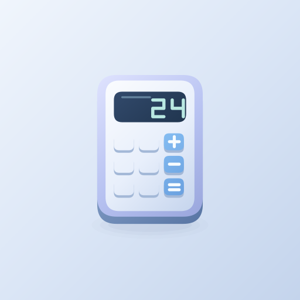

# Calculator | ماشین‌حساب

[دریافت آخرین نسخه / Download latest](https://github.com/cinaasadpour-hash/calculator/releases/latest)

## فارسی

ماشین‌حساب برای انجام محاسبات روزمره و استفاده از عملگرهای علمی در یک رابط ساده طراحی شده است. عبارت‌های محاسباتی را وارد کنید و با پشتیبانی از اعداد فارسی، پرانتز، توان و ریشه، محاسبات خود را انجام دهید.

تاریخچه و حافظهٔ محاسبات به شما کمک می‌کنند نتیجه‌ها را دوباره ببینید و در محاسبات بعدی از آن‌ها استفاده کنید. رابط فارسی و انگلیسی و ظاهر هماهنگ با مجموعهٔ ابزارهای کاربردی، استفاده از برنامه را برای کارهای شخصی، آموزشی و روزانه آسان می‌کنند.

این برنامه دارای تبلیغات است.

### شروع کار

عبارت محاسبه را وارد کنید و نتیجه را بررسی کنید. زبان و ظاهر را از تنظیمات تغییر دهید.

### تبلیغات

بنر استاندارد جدا از کلیدهای محاسبه. نبود تبلیغ مانع استفاده از برنامه نمی‌شود.

## English

Calculator brings everyday arithmetic and scientific operators into a simple interface. Enter expressions using parentheses, powers and roots, with support for Persian digits.

Calculation history and memory help you revisit results and reuse values in later calculations. Persian and English interfaces and a clean, consistent design make the app convenient for personal, educational and daily calculations.

This app contains advertising.

### Getting started

Enter an expression and review the result. Change language and appearance in Settings.

### Advertising

Standard banner separated from calculator keys. An unavailable ad does not block ordinary use.

## Download and updates | دریافت و به‌روزرسانی

Android APK, version **1.0.2**. Package: `com.sinatools.calculator`.
For updates, install over the existing app to preserve its local data. Do not uninstall first.

برای حفظ اطلاعات، نسخه جدید را روی نسخه قبلی نصب کنید؛ ابتدا برنامه را حذف نکنید.

[Privacy / حریم خصوصی](PRIVACY.md)

This repository distributes the signed app and user guide. Private signing keys and local build credentials are not published.
